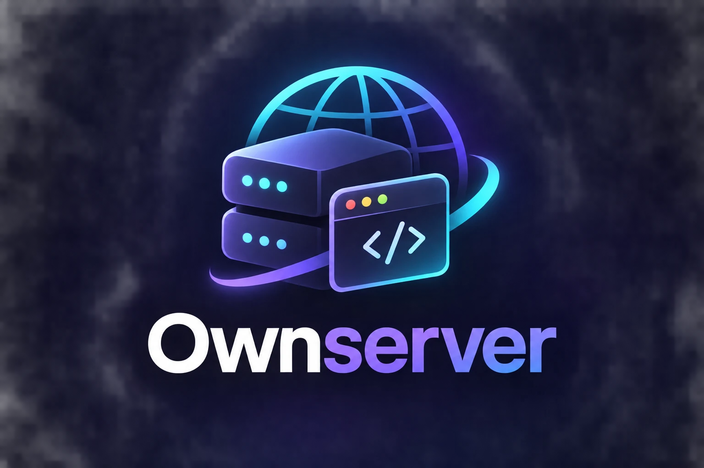

# Ownserver

<p align="center">
  
</p>

<p align="center">
  <a href="https://pypi.org/project/ownserver/"></a>
  <a href="https://pypi.org/project/ownserver/"></a>
</p>

Ownserver serves a directory over HTTP and opens an ngrok tunnel by default. It uses Python's standard library for the local server and the official ngrok Python SDK for the public tunnel.

## Requirements

- Python 3.15 or newer. `uv` can select or install a compatible Python version.
- [uv](https://docs.astral.sh/uv/) installed when using the uv commands below.
- An ngrok account and authtoken when using the default tunnel mode.

Set the token in your shell before starting Ownserver.

macOS/Linux (Bash):

```bash
export NGROK_AUTHTOKEN="YOUR_NGROK_AUTHTOKEN"
```

Windows (PowerShell):

```powershell
$env:NGROK_AUTHTOKEN = "YOUR_NGROK_AUTHTOKEN"
```

The token is read from the environment and is never accepted as a command-line argument.

## Install

The command examples below work in Bash on macOS/Linux and in PowerShell on Windows. Only shell-specific environment variable setup is shown separately.

Install the published package from PyPI with pip into the active Python environment.

```console
pip install ownserver
ownserver -p 8000
```

Install Ownserver from PyPI as a uv tool. This makes the `ownserver` command available without activating a project environment.

```console
uv tool install ownserver
ownserver -p 8000
```

To run it once without installing the tool persistently, use `uv tool run`:

```console
uv tool run ownserver -p 8000
```

Ownserver starts ngrok by default and requires `NGROK_AUTHTOKEN`. Add `--no-ngrok` to serve locally without a token.

## Run from the project

Run these commands from the project directory. `uv run` synchronizes the project environment before starting the command.

```console
uv run ownserver -p 8000
uv run ownserver -p 8000 ./public home.html
uv run ownserver -p 8000 --watch ./public
```

By default, Ownserver starts both the local HTTP server and an ngrok tunnel. It prints the local address and the public ngrok URL. The server listens on `127.0.0.1` unless `--host` is supplied. Use `--domain` with a domain reserved in your ngrok account:

```console
uv run ownserver -p 8000 --domain my-site.ngrok.app ./public
```

Use `--no-ngrok` to serve locally without requiring an ngrok token:

```console
uv run ownserver -p 8000 --no-ngrok ./public
```

The optional positional arguments are the directory to serve (default: current directory) and the file served at `/` (default: `index.html`). `--watch` monitors file and directory changes and reloads open HTML pages. Run `uv run ownserver --help` to see all options.

## JSON output

Use `--json` to write machine-readable status and error records to standard output:

```console
uv run ownserver -p 8000 --json
```

Ownserver writes one compact JSON object per line. The first record reports `server`, `watch`, `directory`, `host`, `port`, and `url`; `url` is `null` when `--no-ngrok` is used. Startup or fatal runtime errors use `server: "error"` and an `error` message. HTTP error responses include an `error`, their status, method, and request path while `server` remains `"ready"`. Human-readable startup, watcher, and access logs remain on standard error.

Example status record:

```json
{"server":"ready","watch":true,"directory":"/path/to/site","host":"http://127.0.0.1","port":8000,"url":"https://example.ngrok.app"}
```

Example HTTP error record:

```json
{"server":"ready","error":"HTTP 404 response","status":404,"method":"GET","path":"/missing"}
```

## Install from a source checkout

From the project directory, install the command into uv's user tool environment:

```console
uv tool install .
```

To locate the executable directory:

```console
uv tool dir --bin
```

If `ownserver` is not found, add the directory printed by `uv tool dir --bin` to your user `PATH`, then restart your shell. Once it is available, run:

```console
ownserver -p 8000
ownserver -p 8000 --no-ngrok
```

Uninstall the user-level command with:

```console
uv tool uninstall ownserver
```
